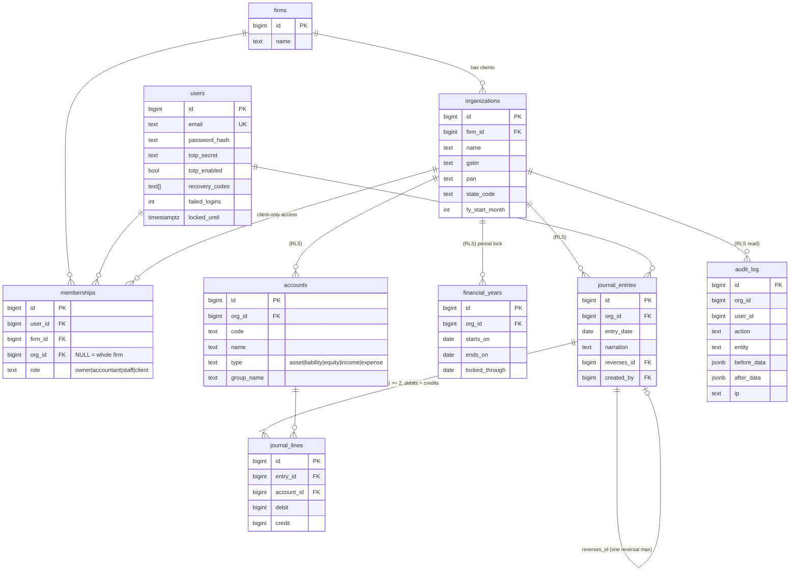

# Phase 1 ER diagram

Money columns are `BIGINT` paise. Tables marked (RLS) are row-level-security protected by `org_id`.

## Database-enforced rules (see db/migrations/001_foundation.sql)
- `journal_entries`, `journal_lines`, `audit_log`: UPDATE and DELETE are blocked by triggers (append-only). Corrections are reversal entries.
- A deferred constraint trigger rejects any entry whose debits do not equal credits, or which has fewer than 2 lines.
- Each line has exactly one of debit/credit, both non-negative.
- Postings dated on or before `financial_years.locked_through` are rejected.
- Row-level security: the API runs tenant queries as role `app_user` with `app.org_id` set, so one client's rows are invisible to another.
